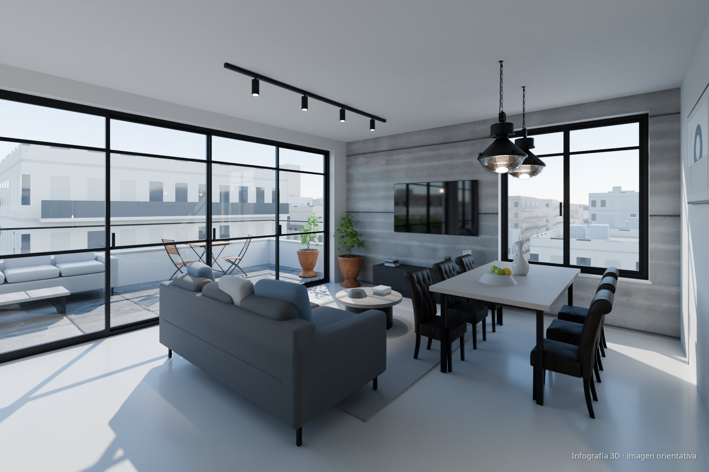
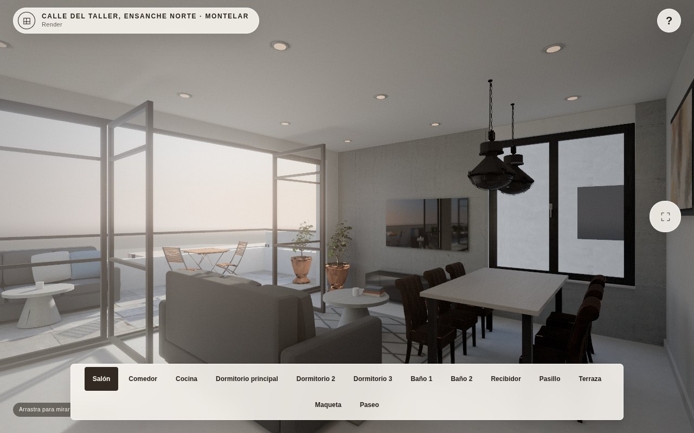
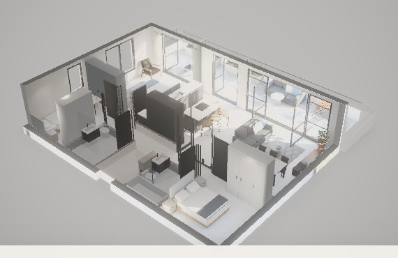
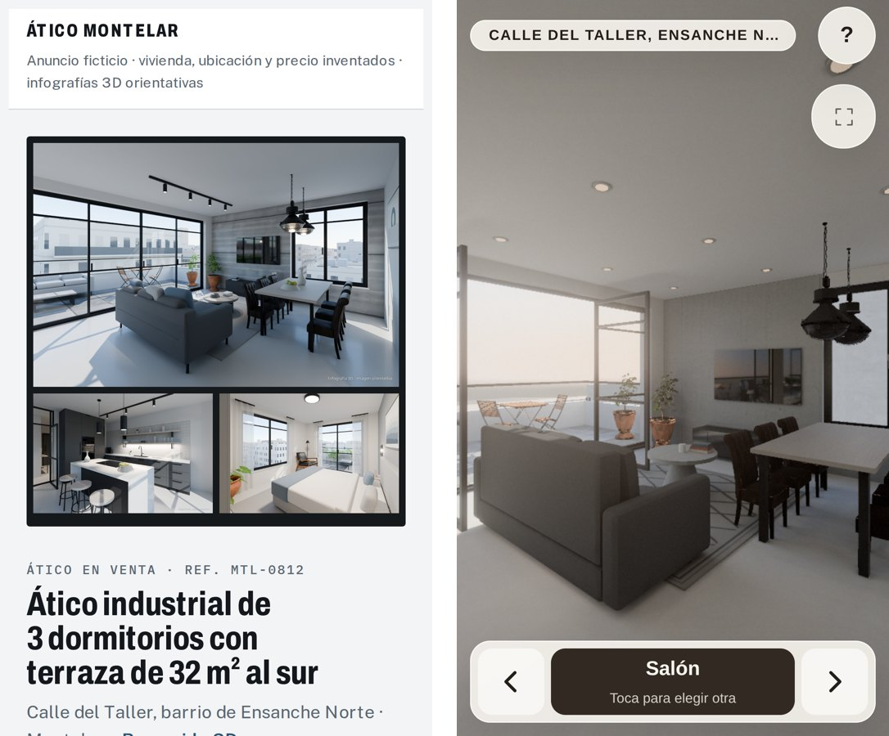

# Ático Montelar · infografías y recorrido 3D

Anuncio inmobiliario **ficticio** de un ático de 3 dormitorios y 2 baños con terraza de 32 m². Incluye 20 infografías renderizadas
con Blender Cycles, un plano en SVG y un recorrido 3D en el navegador con la iluminación horneada.

**▶ Ver online:** [yorkre.github.io/atico-montelar](https://yorkre.github.io/atico-montelar/) ·
[recorrido 3D directo](https://yorkre.github.io/atico-montelar/recorrido/) (funciona en móvil)



> La vivienda, la dirección, la ciudad (Montelar), la referencia y el precio son inventados. Las imágenes son infografías orientativas,
> no fotografías. No hay marcas, logotipos ni personas.

## Qué hay

| | |
|---|---|
| **Página del anuncio** (`index.html`) | Mosaico de fotos, datos clave, descripción, galería filtrable por estancias con visor a pantalla completa y plano acotado. |
| **Recorrido 3D** (`recorrido/`) | Vistas por estancia, paseo libre en primera persona con colisiones y maqueta que se puede orbitar. En el móvil se camina tocando el suelo. |
| **Infografías** (`img/`) | 20 vistas de 1800 × 1200 px renderizadas en Cycles, con marca de agua «Infografía 3D · imagen orientativa». |
| **Plano** (`plano-atico.svg`) | Planta acotada generada a partir de los mismos datos que la escena 3D. |

<p>
  
  
</p>

## Cómo está hecho

Todo sale de **una sola descripción de la vivienda en JSON**: muros, huecos, puertas, 64 muebles, materiales, luminarias y cámaras.
A partir de ella se generan:

- **Comprobaciones previas:**
  - colisiones entre muebles;
  - pasos libres entre muebles de al menos 60 cm;
  - barrido de las puertas;
  - accesibilidad de cada estancia.
- **Escena de Blender:**
  - construida por script;
  - materiales PBR y mobiliario 3D de Poly Haven;
  - luz de una tarde de otoño con orientación sur.
- **Infografías:** renderizadas con Cycles en GPU (OptiX) y postprocesadas con la marca de agua.
- **Plano SVG:** acotado, con el giro de cada puerta.
- **Recorrido 3D (three.js):**
  - La geometría se reconstruye en el navegador a partir de los mismos datos.
  - La luz se **hornea en Cycles** en un lightmap de 2048 × 2048: directa a 8 192 muestras e indirecta a 32 768, más 42 focos empotrados.
  - Por eso se ve con iluminación global realista y va fluido en un móvil.
  - Paseo con colisiones: el cuerpo es un círculo de 40 cm que se desliza por muros y muebles en lugar de frenar en seco.
  - Rutas A* sobre una rejilla de holgura de 5 cm para ir caminando a donde se toca.
  - Una batería de pruebas recorre la casa con el mismo código del visor (pasos entre muebles, puertas, salida a la terraza).
  - Exposición automática y modo maqueta con cortes.

<p align="center"></p>

### Controles del recorrido

| Ordenador | Móvil |
|---|---|
| **W A S D** o **↑ ↓** caminar · **ratón** o **← →** girar · clic en el suelo para ir allí · teclas **1–9** cambian de vista | tocar el suelo para caminar · deslizar para mirar · pellizcar para acercar |

## Estructura

```
index.html          página del anuncio
img/                infografías (y miniaturas en img/min/)
plano-atico.svg     plano de planta
recorrido/          visor 3D: página, lightmap (lm_dia.webp), datos (ficha.json), texturas, modelos y three.js
docs/               capturas de este README
```

Es un sitio estático: no hace falta compilar nada. Para verlo en local, sirve la carpeta con cualquier servidor (`python3 -m http.server`)
y abre `http://localhost:8000`. Abrir los HTML con doble clic no funciona, porque los navegadores no dejan cargar módulos ni texturas
WebGL desde `file://`.

## Créditos

- Modelos 3D, texturas y HDRI: [Poly Haven](https://polyhaven.com), licencia CC0.
- [three.js](https://threejs.org) r186, licencia MIT (`recorrido/lib/three/LICENSE`).
- Tipografías Archivo, Public Sans e IBM Plex Mono, de Google Fonts (SIL Open Font License).
